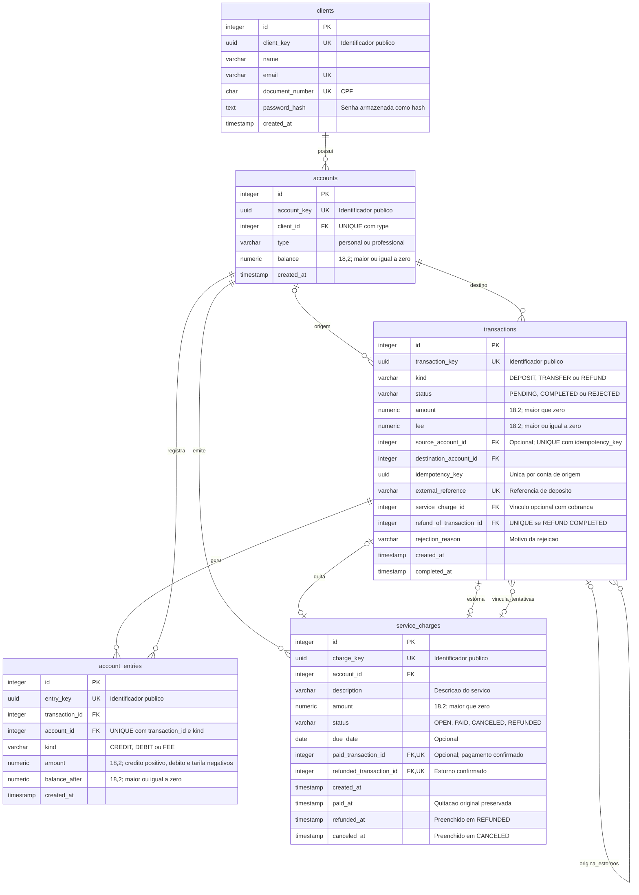
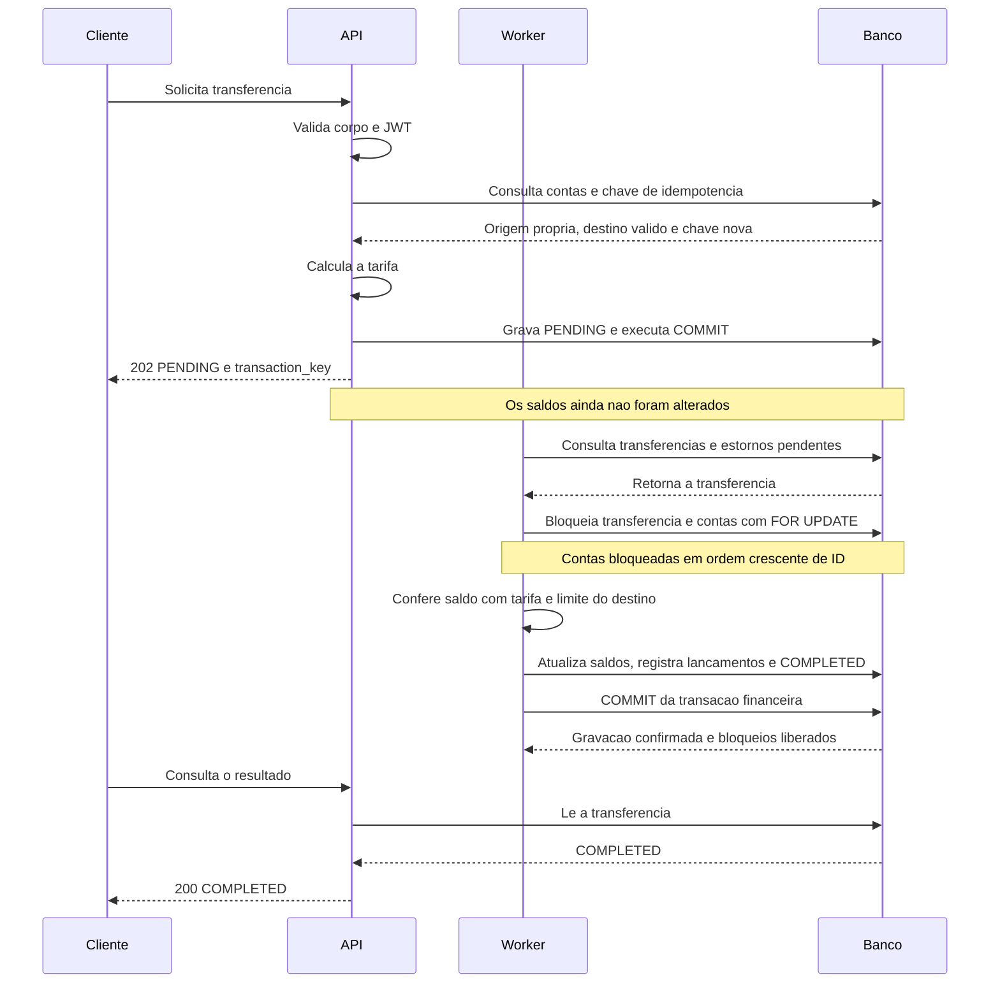
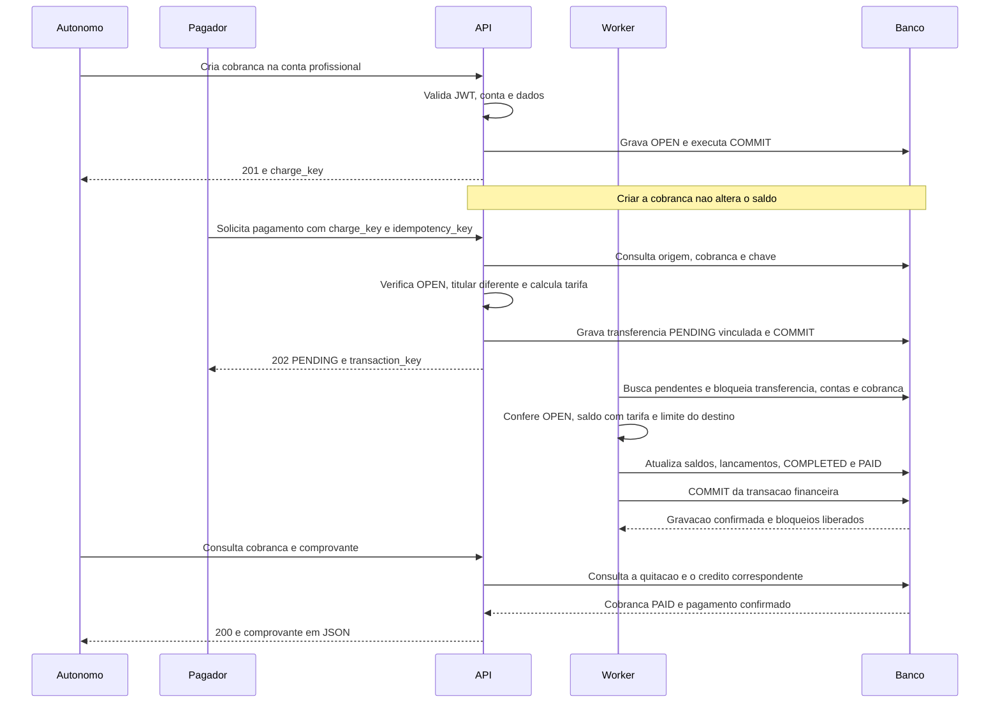

# RFC — Kodama Bank: contas e recebíveis para profissionais autônomos

| | |
|---|---|
| **Time** | João Paulo Motta Travalini · Bruno Bianchi Raiado |
| **Data** | 12/10/2026 |
| **Versão** | 4 |

## Contextualização

### Entendendo o problema

Profissionais autônomos precisam separar o dinheiro pessoal do profissional e acompanhar pagamentos por serviços. O Kodama Bank deve oferecer cadastro, contas pessoal e profissional, depósitos simulados, transferências, saldo e extrato, além de criação, pagamento, cancelamento e estorno de cobranças. É necessário acompanhar recebíveis abertos, pagos, atrasados e devolvidos. O dinheiro e o histórico devem permanecer coerentes: solicitações repetidas ou concorrentes não podem duplicar pagamentos, devoluções ou gastos do mesmo saldo. Falhas não podem deixar débito sem crédito, e devolver um pagamento deve preservar sua movimentação original. Pix, boletos, dinheiro real, estornos parciais e devoluções de depósitos externos simulados ficam fora desta entrega.

### Explicando a solução de forma macro

A solução reúne uma API em Python com FastAPI, PostgreSQL e um worker, executados pelo Docker Compose. A API autentica clientes com JWT e restringe o acesso às suas contas; depósitos simulados e conciliação exigem token interno. Transferências e estornos são persistidos como pendentes e processados pelo worker. Bloqueios protegem os registros concorrentes, enquanto saldos, lançamentos e estados são confirmados na mesma transação de banco. Chaves de idempotência e referências únicas recuperam solicitações repetidas sem nova movimentação. O estorno gera uma operação inversa vinculada ao pagamento, preservando o histórico original. Extrato e comprovantes permitem consultar as movimentações, e a conciliação compara os registros em uma visão consistente dos dados.

- **Event Sourcing com CQRS:** descartado pelo custo de versionar eventos, reconstruir estados e manter projeções de consulta. Ganharia valor com necessidade de reconstrução histórica mais ampla e diferentes modelos de leitura; nesta entrega, saldo, lançamentos e estados são gravados juntos no PostgreSQL.

- **RabbitMQ com Transactional Outbox:** descartado por exigir broker, publicador e tratamento de entregas repetidas. Ganharia valor com múltiplos consumidores ou integrações por eventos; o worker atual retoma os pendentes persistidos no banco.

- **Redis:** descartado por adicionar configuração e coordenação sem uma necessidade demonstrada. Poderia ser considerado para um caso concreto de cache ou fila; não é necessário para persistir e retomar as operações desta entrega.

- **OpenTelemetry e Jaeger:** adiados pelo custo de instrumentar e propagar contexto entre API e worker. Ganhariam valor com maior necessidade de diagnóstico distribuído; nesta entrega, logs registram requisições e resultados do processamento.

## Implementação

### Rotas

| Método | Caminho | O que faz | Entrada (campos que importam) | Saídas (status e quando) |
|---|---|---|---|---|
| `POST` | `/clients` | Cadastra o cliente e cria suas contas pessoal e profissional. Sem chave de idempotência; CPF e e-mail únicos impedem cadastros duplicados. | `name`, `email`, `document_number`, `password`. Sem autenticação. | `201`: cliente e contas criados; `400`: corpo fora do formato esperado; `422`: CPF com formato aceito, mas inválido; `409`: CPF ou e-mail já cadastrado. |
| `POST` | `/auth/login` | Autentica o cliente e emite um novo JWT a cada login válido. | `email`, `password`. Sem autenticação prévia. | `200`: JWT emitido; `400`: corpo inválido; `401`: e-mail desconhecido ou senha incorreta. |
| `GET` | `/clients/me` | Consulta o perfil e as contas do cliente autenticado. Leitura idempotente. | JWT no cabeçalho `Authorization: Bearer`. | `200`: perfil retornado; `401`: token ausente, inválido ou expirado. |
| `GET` | `/accounts` | Lista as contas pessoal e profissional do cliente, com seus saldos. Leitura idempotente. | JWT no cabeçalho `Authorization: Bearer`. | `200`: contas retornadas; `401`: token ausente, inválido ou expirado. |
| `GET` | `/accounts/{account_key}` | Consulta uma conta pertencente ao cliente autenticado. Leitura idempotente. | `account_key` e JWT. | `200`: conta e saldo retornados; `400`: chave fora do formato UUID; `401`: token ausente, inválido ou expirado; `404`: conta inexistente ou pertencente a outro cliente. |
| `GET` | `/accounts/{account_key}/entries` | Consulta o extrato paginado, com filtro opcional por tipo de lançamento. Leitura idempotente. | `account_key`, JWT e parâmetros opcionais `page`, `limit` e `kind` (`CREDIT`, `DEBIT` ou `FEE`). | `200`: extrato retornado; `400`: UUID, paginação ou filtro inválido; `401`: token ausente, inválido ou expirado; `404`: conta inexistente ou pertencente a outro cliente. |
| `POST` | `/accounts/{account_key}/deposits` | Registra um depósito simulado. Idempotente por `external_reference` única: repetir conta, valor e referência recupera a operação sem novo crédito. | `account_key`, `amount`, `external_reference` e cabeçalho `INTERNAL-TOKEN`. | `201`: depósito registrado ou recuperado; `400`: UUID ou corpo inválido; `403`: token interno ausente ou incorreto; `404`: conta inexistente; `409`: referência reutilizada com dados diferentes ou incompatível com a cobrança; `422`: valor zero ou limite de saldo excedido. |
| `POST` | `/accounts/{source_account_key}/transfers` | Solicita uma transferência. Idempotente pela combinação da conta de origem com `idempotency_key`. | `source_account_key`, JWT, `destination_account_key`, `amount` e `idempotency_key`. | `202`: operação pendente; `200`: resultado final disponível; `400`: UUID ou corpo inválido; `401`: JWT ausente, inválido ou expirado; `404`: origem inacessível ou destino inexistente; `409`: chave reutilizada com dados diferentes; `422`: valor zero ou origem igual ao destino. |
| `GET` | `/accounts/{source_account_key}/transfers/{transaction_key}` | Consulta estado, valor, tarifa e eventual motivo de rejeição da transferência. Leitura idempotente. | `source_account_key`, `transaction_key` e JWT. | `200`: operação retornada; `400`: UUID inválido; `401`: JWT ausente, inválido ou expirado; `404`: origem inacessível ou transferência não encontrada nessa conta. |
| `POST` | `/accounts/{account_key}/charges` | Cria uma cobrança `OPEN` na conta profissional, sem alterar o saldo. Sem chave de idempotência: cada chamada válida cria uma nova cobrança. | `account_key`, JWT, `description`, `amount` e `due_date` opcional. | `201`: cobrança criada; `400`: UUID, corpo ou data inválida; `401`: JWT ausente, inválido ou expirado; `404`: conta inexistente ou de outro cliente; `422`: conta pessoal ou valor zero. |
| `GET` | `/accounts/{account_key}/charges` | Lista as cobranças da conta com paginação e indicação de atraso. Leitura idempotente. | `account_key`, JWT e parâmetros opcionais `page` e `limit`. | `200`: listagem retornada, inclusive vazia; `400`: UUID ou paginação inválida; `401`: JWT ausente, inválido ou expirado; `404`: conta inexistente ou de outro cliente. |
| `GET` | `/accounts/{account_key}/charges/summary` | Resume quantidades e valores de cobranças abertas, atrasadas, pagas e estornadas da conta profissional. Leitura idempotente. | `account_key` e JWT. | `200`: resumo retornado; `400`: UUID inválido; `401`: JWT ausente, inválido ou expirado; `404`: conta inexistente ou de outro cliente; `422`: conta pessoal. |
| `GET` | `/accounts/{account_key}/charges/{charge_key}` | Consulta uma cobrança do titular, incluindo estado, vencimento e indicação de atraso. Leitura idempotente. | `account_key`, `charge_key` e JWT. | `200`: cobrança retornada; `400`: UUID inválido; `401`: JWT ausente, inválido ou expirado; `404`: conta inacessível ou cobrança não encontrada nessa conta. |
| `GET` | `/accounts/{account_key}/charges/{charge_key}/receipt` | Retorna o comprovante do pagamento original em JSON, inclusive após estorno, vinculando pagamento e crédito. Leitura idempotente. | `account_key`, `charge_key` e JWT. | `200`: comprovante retornado; `400`: UUID inválido; `401`: JWT ausente, inválido ou expirado; `404`: conta inacessível ou cobrança não encontrada; `409`: cobrança não paga; `500`: inconsistência nos registros do pagamento. |
| `POST` | `/accounts/{account_key}/charges/{charge_key}/cancel` | Cancela uma cobrança `OPEN`, preservando o histórico. Idempotente pelo estado: repetir o cancelamento retorna a cobrança já cancelada. | `account_key`, `charge_key` e JWT. Sem corpo obrigatório. | `200`: cobrança cancelada ou cancelamento recuperado; `400`: UUID inválido; `401`: JWT ausente, inválido ou expirado; `404`: conta inacessível ou cobrança não encontrada; `409`: cobrança paga ou estornada. |
| `POST` | `/accounts/{source_account_key}/charge-payments` | Solicita o pagamento de uma cobrança; valor e destino são obtidos da própria cobrança. Idempotente pela conta de origem e `idempotency_key`, compartilhada com transferências e estornos. | `source_account_key`, JWT, `charge_key` e `idempotency_key`. | `202`: operação pendente; `200`: resultado final disponível; `400`: UUID ou corpo inválido; `401`: JWT ausente, inválido ou expirado; `404`: origem inacessível ou cobrança inexistente; `409`: chave reutilizada com dados diferentes ou nova tentativa para cobrança paga, cancelada ou estornada; `422`: tentativa de pagar a própria cobrança. |
| `POST` | `/accounts/{account_key}/charges/{charge_key}/refunds` | Solicita estorno integral de pagamento por transferência Kodama. Idempotente pela conta de origem e `idempotency_key`, compartilhada com transferências e pagamentos. | `account_key`, `charge_key`, JWT do titular e somente `idempotency_key` no corpo. Valor e destino vêm do pagamento original. | `202`: estorno pendente; `200`: resultado final recuperado; `400`: UUID ou corpo inválido; `401`: JWT ausente, inválido ou expirado; `404`: conta inacessível ou cobrança inexistente; `409`: cobrança inelegível, já estornada ou conflito de chave; `500`: vínculo financeiro inconsistente. |
| `GET` | `/accounts/{account_key}/charges/{charge_key}/refunds/{transaction_key}` | Consulta estado, valor, vínculo original e motivo de rejeição do estorno. Leitura idempotente. | `account_key`, `charge_key`, `transaction_key` e JWT do titular. | `200`: estorno retornado; `400`: UUID inválido; `401`: JWT ausente, inválido ou expirado; `404`: conta, cobrança ou estorno inacessível; `500`: vínculo financeiro inconsistente. |
| `GET` | `/accounts/{account_key}/charges/{charge_key}/refunds/{transaction_key}/receipt` | Retorna comprovante JSON do estorno concluído, associado ao pagamento e aos dois lançamentos. Leitura idempotente. | `account_key`, `charge_key`, `transaction_key` e JWT do titular. | `200`: comprovante retornado; `400`: UUID inválido; `401`: JWT ausente, inválido ou expirado; `404`: conta, cobrança ou estorno inacessível; `409`: estorno pendente ou rejeitado; `500`: registros inconsistentes. |
| `GET` | `/internal/accounts/{account_key}/reconciliation` | Compara saldo, lançamentos, pagamentos originais e estornos, sem alterar os registros. Leitura idempotente. | `account_key` e cabeçalho `INTERNAL-TOKEN`. | `200`: relatório retornado, com `consistent` e eventuais divergências; `400`: UUID inválido; `403`: token interno ausente ou incorreto; `404`: conta inexistente. |
| `GET` | `/health_check` | Verifica se a API responde. Leitura idempotente. | Nenhuma. Sem autenticação. | `204`: API respondeu, sem corpo. |
| `GET` | `/` | Retorna o nome do serviço e o identificador do processo. Leitura idempotente. | Nenhuma. Sem autenticação. | `200`: identificação retornada. |

O resumo usa a data em São Paulo. `overdue` é um subconjunto de `open`; `paid` inclui somente cobranças atualmente pagas, e `refunded` inclui as devolvidas. Esses valores não representam o saldo disponível. Os comprovantes descrevem operações simuladas e usam `Cache-Control: no-store`.

### Banco de Dados (Somente diagrama)

### Fluxos

**Transferência — caminho feliz**

A tarifa é gratuita entre contas do mesmo cliente. Entre clientes diferentes, corresponde a 0,5% do valor, arredondada para centavos e limitada a R$ 2,00. Ela é debitada da origem somente na conclusão; o destino recebe o valor integral. Tarifa zero não gera lançamento de tarifa no extrato.

**Transferência — falha: saldo insuficiente**

1. A solicitação já está registrada como `PENDING`. O worker bloqueia a transferência e as duas contas.
2. O saldo da origem não cobre o valor somado à tarifa.
3. O worker grava `REJECTED` com `rejection_reason: INSUFFICIENT_FUNDS` e confirma essa decisão. Os saldos permanecem iguais e nenhum lançamento é criado.
4. A consulta retorna `200` com o estado `REJECTED`. Repetir a solicitação com a mesma chave recupera essa rejeição; uma nova tentativa exige outra chave de idempotência.

**Transferência — falha técnica e retomada**

1. Uma falha técnica antes do commit interrompe o processamento. As alterações ainda não confirmadas são desfeitas pelo rollback.
2. A transferência permanece `PENDING`, sem movimentação financeira parcial.
3. O worker registra o erro e agenda nova tentativa com espera progressiva, limitada a 60 segundos. Após uma reinicialização, volta a consultar os pendentes persistidos no banco.
4. Ao tentar novamente, bloqueia o registro e verifica seu estado. Se outra execução já concluiu ou rejeitou a operação, retorna o resultado existente sem repetir a movimentação.

**Cobrança — caminho feliz: pagamento por outro cliente**

O valor e a conta de destino são obtidos da cobrança; o pagador não pode alterá-los na solicitação. Débito, tarifa, crédito, conclusão da transferência e quitação da cobrança são confirmados juntos. O profissional recebe o valor integral, e a tarifa é cobrada do pagador.

**Cobrança — falha: saldo insuficiente**

1. O pagamento está `PENDING`, mas o worker identifica que o saldo do pagador não cobre o valor e a tarifa.
2. A transferência é marcada como `REJECTED`, com motivo `INSUFFICIENT_FUNDS`, sem débito, crédito ou tarifa.
3. A cobrança permanece `OPEN`. Após obter saldo, o pagador pode tentar novamente com uma nova chave de idempotência.

**Cobrança — falha: duas tentativas de pagamento**

1. Duas solicitações com chaves diferentes encontram a mesma cobrança aberta e geram transferências `PENDING`.
2. A primeira execução bloqueia os registros envolvidos e confirma o pagamento e a quitação na mesma transação.
3. A execução seguinte, ao obter os bloqueios, encontra a cobrança `PAID` ou `REFUNDED`.
4. Essa segunda transferência é marcada como `REJECTED`, com motivo `CHARGE_ALREADY_PAID`, sem movimentar saldo nem cobrar tarifa. Sua consulta retorna `200` com esse resultado.

Uma cobrança estornada não volta a ficar aberta e não pode receber um novo pagamento.

O mesmo bloqueio protege a disputa entre uma transferência pendente e um depósito interno para quitar a cobrança: a operação que confirmar primeiro impede uma segunda quitação.

**Estorno de cobrança — caminho feliz**

1. A API autentica o titular da conta profissional e consulta a cobrança. Para uma chave nova, exige `PAID` e um pagamento original `TRANSFER` concluído por outro cliente Kodama.
2. Obtém o valor e a conta pagadora do pagamento original; o corpo não pode escolher valor ou destino. Grava `REFUND` como `PENDING`, com tarifa zero, vínculo à cobrança e `refund_of_transaction_id`, e retorna `202`.
3. O worker bloqueia o estorno, as contas em ordem crescente de ID e a cobrança. Confere novamente estado, vínculo original, saldo do profissional e limite da conta pagadora.
4. Debita o valor integral do profissional, credita a conta que pagou e cria os dois lançamentos. Grava o estorno `COMPLETED` e a cobrança `REFUNDED`, com identificação e data da devolução, no mesmo commit.
5. O pagamento original permanece `COMPLETED`, com seus lançamentos e tarifa intactos. A devolução não cobra nova tarifa e não restitui a original.
6. A consulta retorna `200`. O comprovante do estorno identifica as duas movimentações; o comprovante do pagamento original continua disponível. O resumo move a cobrança de `paid` para `refunded`.

Somente estornos integrais de pagamentos entre clientes Kodama são elegíveis. Depósitos internos não identificam uma conta pagadora Kodama para receber a devolução. Uma tentativa nova para cobrança aberta, cancelada, quitada por depósito ou já estornada recebe `409`, sem criar uma devolução.

**Estorno de cobrança — falha: saldo insuficiente ou limite do destino**

1. O estorno foi aceito como `PENDING`, mas, sob os bloqueios, o saldo do profissional não cobre a devolução ou o destino não comporta o crédito.
2. O worker confirma `REJECTED`, com `INSUFFICIENT_FUNDS` ou `DESTINATION_LIMIT_EXCEEDED`. Não cria lançamentos nem altera saldos; a cobrança permanece `PAID`.
3. A mesma chave recupera essa rejeição. Após resolver a causa, uma nova chave permite tentar novamente. Uma falha técnica anterior ao commit provoca rollback e mantém o estorno `PENDING` para retomada.

**Estorno de cobrança — repetição e concorrência**

1. Pedidos simultâneos com a mesma chave disputam a restrição única da conta de origem e recuperam o mesmo estorno. Usar a chave em outra cobrança, transferência ou pagamento recebe `409`.
2. Com chaves diferentes, duas tentativas podem ficar `PENDING`. A primeira que obtiver os bloqueios e atender às regras confirma a devolução e marca a cobrança `REFUNDED`.
3. A seguinte encontra `REFUNDED` e é rejeitada com `CHARGE_ALREADY_REFUNDED`, sem nova movimentação. O índice único condicional também impede dois estornos `COMPLETED` para o mesmo pagamento original.
4. Após a conclusão, repetir a chave do estorno recupera `200 COMPLETED`; uma chave nova recebe `409`. Reiniciar o worker não muda esses resultados nem duplica lançamentos. Os pendentes persistidos são retomados quando ele volta a funcionar.

**Cancelamento de cobrança — caminho feliz**

1. A API autentica o titular, confere a conta e bloqueia a cobrança.
2. Se ela estiver `OPEN`, grava `CANCELED` e a data de cancelamento, sem alterar saldo ou extrato.
3. Confirma a alteração e retorna `200`. Repetir o cancelamento retorna a cobrança já cancelada, preservando a data original.

**Cancelamento de cobrança — falha: disputa com um pagamento**

1. O cancelamento e o processamento do pagamento disputam o bloqueio da mesma cobrança.
2. Se o pagamento confirmar primeiro, a cobrança fica `PAID` e o cancelamento recebe `409`, sem alterar os registros. Uma cobrança posteriormente estornada também não pode ser cancelada.
3. Se o cancelamento confirmar primeiro, a cobrança fica `CANCELED`. Ao processar o pagamento pendente, o worker grava `REJECTED` com motivo `CHARGE_CANCELED`, sem débito, crédito ou tarifa.
4. Uma nova solicitação de pagamento para a cobrança cancelada recebe `409`.

**Depósito interno — caminho feliz**

1. A API exige o token interno e valida os dados do depósito.
2. Bloqueia a conta de destino e verifica a referência externa. Se ela identificar uma cobrança, bloqueia também essa cobrança e confere conta, valor e estado `OPEN`.
3. Registra o depósito `COMPLETED`, o lançamento de crédito e o novo saldo. Quando houver cobrança vinculada, também grava `PAID` e identifica a transação que a quitou.
4. Confirma todas as alterações juntas e retorna `201`. Esse fluxo simula um recebimento; não verifica liquidação por uma instituição externa.

**Depósito interno — repetição e conflito de referência**

1. Uma referência já registrada, com a mesma conta e o mesmo valor, recupera o depósito original sem novo crédito.
2. Reutilizar a referência com outra conta ou valor recebe `409`, sem alterar o saldo.
3. Uma referência de cobrança inexistente, cancelada, estornada ou incompatível com conta e valor também recebe `409`. Uma cobrança já paga só permite recuperar o depósito que originalmente a quitou.

**Cadastro — caminho feliz**

1. A API valida os campos e o CPF, normaliza o documento e converte o e-mail para minúsculas.
2. Verifica se CPF e e-mail já estão cadastrados.
3. Armazena a senha como hash e cria o cliente com suas contas pessoal e profissional, ambas com saldo inicial zero.
4. Confirma cliente e contas na mesma transação e retorna `201` com seus identificadores públicos, sem expor o hash da senha.

**Cadastro — falha: CPF ou e-mail duplicado**

1. Se CPF ou e-mail já existirem, a API retorna `409` sem criar novos registros.
2. As restrições únicas do banco também protegem contra cadastros simultâneos. Se uma duplicidade ocorrer durante a gravação, o rollback desfaz o cadastro inteiro e a API retorna `409`.

**Conciliação interna — caminho feliz**

1. A API exige o token interno e inicia uma transação somente de leitura com isolamento `REPEATABLE READ`.
2. Consulta o saldo da conta e soma os lançamentos de crédito, débito e tarifa.
3. Para cobranças da conta em `PAID` ou `REFUNDED`, confere o pagamento original concluído, a conta de destino, o valor e o crédito correspondente.
4. Para estornos ligados à conta profissional ou pagadora, confere pagamento original, vínculo, direção, valor, tarifa zero, data e os dois lançamentos da devolução.
5. Retorna `200` com `consistent: true` quando as verificações não encontram divergências.

**Conciliação interna — falha: divergência financeira**

1. A consulta identifica diferença entre saldo e soma dos lançamentos, ou incompatibilidade nos registros do pagamento ou estorno de uma cobrança.
2. Retorna `200` com `consistent: false` e os problemas encontrados em `issues`.
3. Os registros permanecem intactos. A conciliação detecta e informa a divergência; não corrige valores automaticamente.

O isolamento mantém as consultas na mesma visão dos dados, evitando comparar um saldo anterior a uma transferência com lançamentos posteriores a ela.

> **Principal desafio**
>
> - **Qual é:** impedir pagamentos e estornos duplicados e manter saldo, extrato e estado da cobrança coerentes diante de concorrência, repetição de solicitações e falhas.
> - **Por que é difícil:** duas operações podem disputar o mesmo saldo, pagamento ou cobrança, e o cliente pode reenviar um pedido cujo resultado ainda não recebeu. Verificar os dados antes de gravar, sem proteger esse intervalo, permite que ambas avancem com informações desatualizadas.
> - **Como o desenho resolve:** restrições únicas identificam solicitações repetidas, e um índice condicional limita cada pagamento a um estorno concluído. O processamento bloqueia a transação, as contas em ordem crescente de ID e, quando aplicável, a cobrança. As regras são verificadas sob esses bloqueios. Saldos, lançamentos e estados são confirmados na mesma transação; falhas anteriores ao commit são desfeitas. Operações pendentes persistem para retomada, enquanto estados finais impedem uma nova movimentação. A devolução cria uma nova transação e preserva o pagamento original. Os testes exercitam concorrência, retentativas, rollback, divergências introduzidas no banco e recuperação de transferências e estornos após indisponibilidade do worker.